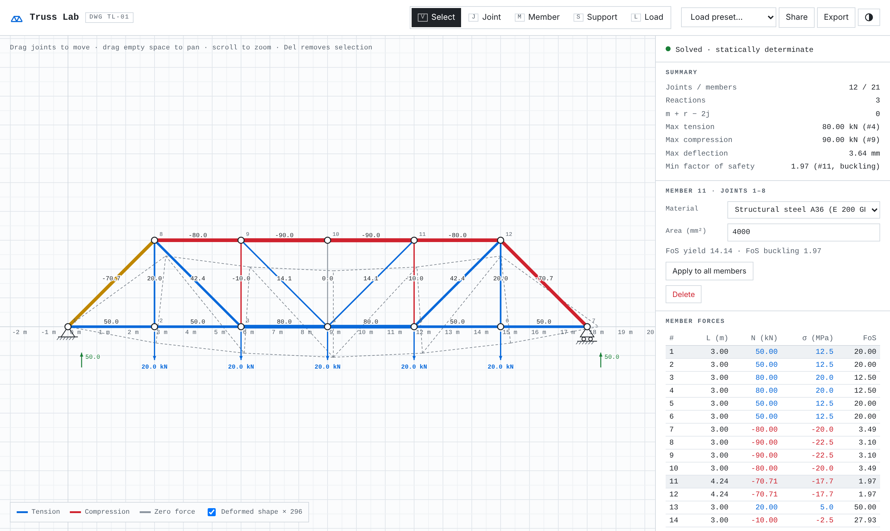

# Truss Lab

[](https://github.com/Haneet10/Truss-Lab/actions/workflows/ci.yml)


**Draw a 2D truss in the browser and watch member forces, stresses, deflection and factors of safety update as you drag.**

**[Open the live app →](https://haneet10.github.io/Truss-Lab/)**

<picture>
  <source media="(prefers-color-scheme: dark)" srcset="docs/screenshot-dark.png">
  
</picture>

## What it does

- **Live solve.** Every edit re-solves the structure with the direct stiffness method, fast enough to run on each mouse move.
- **Reads like a hand sketch.** Members are coloured by tension or compression with line weight proportional to force. Loads, support reactions and an exaggerated deformed shape are drawn on the sheet.
- **Design checks.** Each member gets axial stress, a yield factor of safety and an Euler buckling factor of safety. The governing one is reported, so you can see why a member fails.
- **Stability diagnostics.** The app shows Maxwell's count `m + r − 2j`. If the stiffness matrix is singular, it names the joint that can move freely, so you know where the mechanism is.
- **Presets.** Pratt, Howe and Warren bridges, a Fink-style roof and a wall-mounted cantilever bracket.
- **Shareable.** The whole truss is encoded in the URL, so a link reproduces it exactly. You can also export the model and its results as JSON.
- **Zero dependencies.** Plain ES modules with no build step and no framework.

## Using it

| Tool | Key | Action |
|---|---|---|
| Select | `V` | Drag joints, drag empty space to pan, scroll to zoom, `Del` deletes |
| Joint | `J` | Click to place a joint (snaps to a 0.5 m grid) |
| Member | `M` | Click joint → joint to connect; click empty space to add and connect in one go; `Esc` stops |
| Support | `S` | Click a joint to cycle free → pin → roller (vertical) → roller (horizontal) |
| Load | `L` | Click a joint to add 10 kN down, then edit Fx / Fy in the panel |
| Fit | `F` | Fit the drawing to the screen |

Click any member, or its row in the table, to change its material (A36 steel, 6061-T6 aluminium, Ti-6Al-4V, Douglas fir) or its cross-sectional area.

## How the solver works

[`src/solver.js`](src/solver.js) is a self-contained module with no DOM access:

1. For each member with length `L`, direction cosines `c, s` and axial stiffness `k = EA/L`, it adds the 4×4 element stiffness `k · tᵀt` (where `t = [−c, −s, c, s]`) into the global matrix `K`.
2. It partitions `K` into free and restrained degrees of freedom and solves `K_ff · d_f = F_f` by Gaussian elimination with partial pivoting. A pivot that is effectively zero means a mechanism.
3. Member force is `N = k · t · d`, positive in tension, and stress is `σ = N / A`.
4. Reactions are recovered as `R = K · d − F` at the supported degrees of freedom.
5. The buckling check treats each compression member as a pinned-pinned Euler column with a solid round section (`I = A² / 4π`): `P_cr = π²EI / L²`.

Units: m, kN, GPa and mm², so stiffness is in kN/m and stress in MPa.

**Assumptions.** Pin-jointed members carrying axial force only, loads applied at the joints, linear-elastic material and small displacements. The section shape is only used for buckling. Treat the result as a hand-calc check, not a substitute for a design code.

## Tests

```bash
npm test
```

The test suite uses Node's built-in test runner, so there is nothing to install. Every result is checked against an independent hand calculation:

- Method of joints on a symmetric triangle: 5 kN chord tension and 7.07 kN diagonal compression
- Method of sections on a Pratt bridge: 30 kN bottom chord and 40 kN top chord
- Axial bar deflection `δ = PL/EA`
- Euler buckling load of a slender strut
- Mechanism detection on an unbraced square
- Equilibrium (ΣR = −ΣF) for every preset and for an indeterminate truss

## Running locally

Browsers don't load ES modules from `file://`, so serve the folder with any static server:

```bash
npm start            # or: python -m http.server
```

## Project layout

```
index.html            app shell
styles.css            light/dark theme, layout
src/solver.js         direct stiffness solver (pure, tested)
src/presets.js        starter trusses
src/app.js            SVG editor, interaction, results panel
tests/solver.test.js  hand-checked test cases
.github/workflows/    CI: tests on every push and PR, then deploy to GitHub Pages
```

## License

MIT
